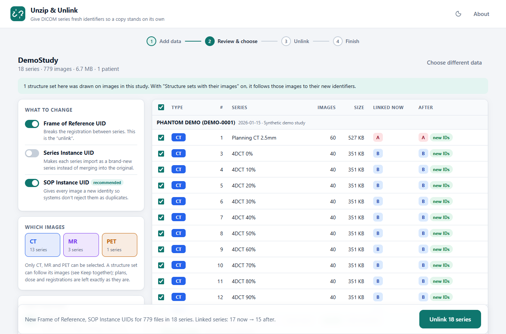
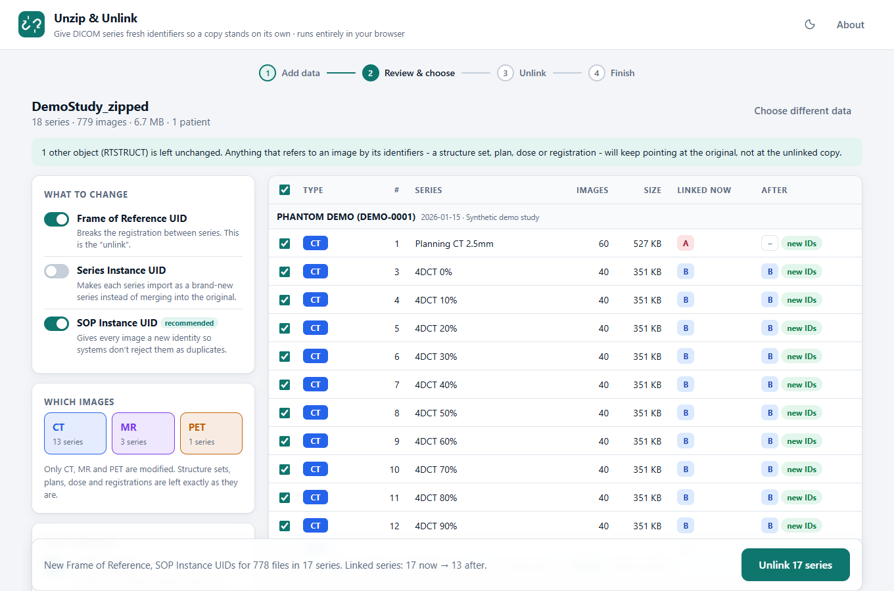
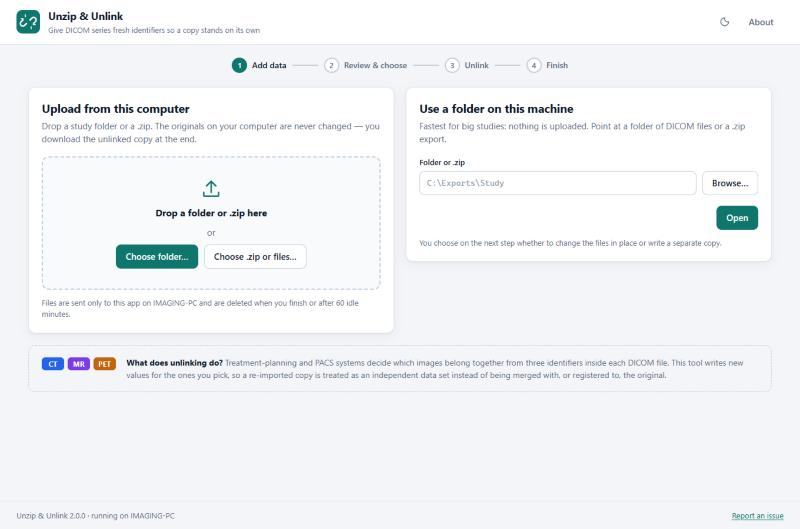
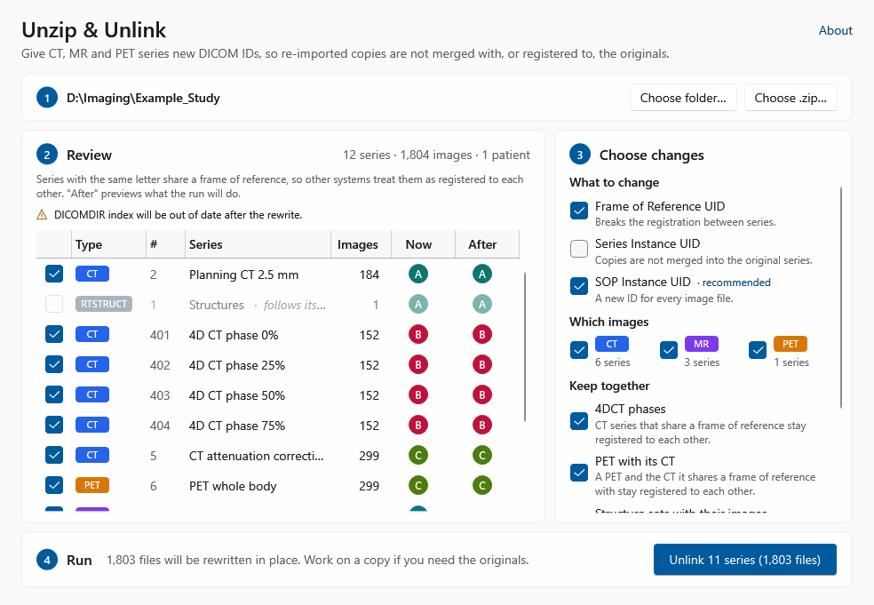

# Unzip & Unlink

Rewrites the DICOM identifiers that tie imaging series together, so a copied or re-imported study is
treated as independent data instead of being merged with, or registered to, the original.

It runs three ways, on the same engine:

| | Browser (`UnzipUnlink.Browser`) | Web app (`UnzipUnlink.Web`) | Desktop app (`UnzipUnlinkGUI`) |
|---|---|---|---|
| Runs in | Any modern browser, from a web page - nothing to install or run | Any modern browser, talking to the app running on a PC or server | Windows (WPF) |
| Data | Open a folder / .zip and download the result; files never leave your computer | Upload a folder / .zip and download the result, **or** point at a folder on the machine it runs on | A folder or .zip on your PC |
| Good for | Trying it out, or occasional use with nothing to install | A shared department server, or a single PC with nothing to install | A single PC |



## Try it in your browser

**<https://brianmanderson.github.io/Unzip_Unlink_Csharp/>**

The browser edition is the same engine compiled to WebAssembly. Everything happens inside your
browser tab: your DICOM files are read and rewritten on your computer and are **never uploaded** -
not to GitHub, not to anyone. The page loads no trackers or third-party content. The page itself is
public, so check with your institution before using it with patient data; the desktop app is the
fully offline alternative. Hosting details, and the points an institution may want to review, are in
[docs/hosting-on-github-pages.md](docs/hosting-on-github-pages.md).



## What it does

1. **Unzips** `.zip` exports (optional).
2. **Scans** the folder tree and groups every DICOM file by series. Only headers are read, so a
   2,000-image study is listed in a second or two.
3. Shows you **what is linked today** (series that share a Frame of Reference UID are registered to
   each other) and **what will be linked afterwards**, before anything is written.
4. **Writes new identifiers** into the series you pick:

   | Identifier | Tag | Effect of replacing it |
   |---|---|---|
   | Frame of Reference UID | (0020,0052) | Breaks the registration between series. This is the "unlink". |
   | Series Instance UID | (0020,000E) | The series imports as a new series instead of merging into the original. |
   | SOP Instance UID | (0008,0018) | Every image gets a new identity, so it is not rejected as a duplicate. Recommended whenever anything else changes. |

Only **CT, MR and PET** series can be selected. Plans, dose, registrations and anything else are
listed but left byte-for-byte unchanged - which also means they keep pointing at the *original*
images, not at the unlinked copy. Structure sets are the exception: see "keep together" below.

Three "keep together" options preserve links you still want:

- **4DCT phases** - CT series that share a frame of reference get one new, shared frame of reference.
- **PET with its CT** - where a PET and a CT share a frame of reference, they keep sharing a new one.
- **Structure sets with their images** - an RT Structure Set drawn on a series you are changing is
  rewritten so that everything it points at follows that series to its new identifiers: the frame of
  reference and series under *Referenced Frame of Reference Sequence*, the frame each ROI is defined
  in, and the image behind every contour. The structure set keeps its own SOP and Series Instance
  UIDs, and its contours are not touched. It is matched to its images by the series it names, or,
  when it names none that are in the study, by frame of reference. A structure set whose images are
  not in the study, or are not selected, is left alone, and the preview says so. The option is
  switched on for you when the scan finds a structure set together with its images.

### Changing other tags

Under **Change other tags** you can overwrite any ordinary DICOM tag with a value you type, for
example `PatientID` or `StudyDescription`. Search the list by keyword, name or tag number
(`0010,0020`), pick a tag and enter its new value; an empty value clears the tag. The value is written
to every file of every selected series (and to a structure set that follows them), in the same pass
as the new identifiers - or on its own, with every identifier switched off.

- Values are checked against the tag's type before anything is written (length, allowed characters,
  date / time / number formats), and the run is blocked until they are valid.
- Only top-level tags can be changed, not tags inside sequences.
- Identifiers (every UID), sequences, binary data, the file meta group and *Specific Character Set*
  are not offered, so an edit cannot break the links the tool manages. Values are limited to plain
  ASCII because the file's character set is left as it is.
- The preview shows *old value → new value* per series. The old value is sampled from the first and
  last image of each series, and shown as "differs between images" when those two disagree.
- The UID report records the tags and the new values you entered. Old values are never written to it.

Every other piece of every file - pixel data, transfer syntax, all other tags - is preserved exactly.

## Quick start

Prebuilt, self-contained Windows builds (nothing to install) are on the
[Releases page](https://github.com/brianmanderson/Unzip_Unlink_Csharp/releases):

- `UnzipUnlink-Web-win-x64.zip` - unzip, run `UnzipUnlinkWeb.exe`; your browser opens at
  <http://localhost:5080> (or the next free port if 5080 is taken).
- `UnzipUnlink-Desktop-win-x64.zip` - unzip, run `UnzipUnlinkGUI.exe`.

From source (needs the [.NET 10 SDK](https://dotnet.microsoft.com/download)):

```powershell
dotnet run --project UnzipUnlink.Web      # web app at http://localhost:5080
dotnet run --project UnzipUnlinkGUI       # desktop app (Windows)
dotnet test                               # verification gate
```

## Web app



Four steps: **Add data -> Review & choose -> Unlink -> Finish.**

- **Upload from this computer** - drop a study folder or a .zip (or use the buttons). The originals on
  your computer are never touched; at the end you download `<name>_unlinked.zip`.
- **Use a folder on this machine** - type or browse to a folder or .zip on the computer the app is
  running on. Nothing is uploaded, so this is the fastest route for large studies. You choose whether
  to change the files in place (like the desktop app) or to write a separate `<folder>_unlinked` copy.
- The **Finish** step offers a UID report (`.csv`) listing the old and new identifiers of each series.
  It contains no patient details.

### Privacy and safety

- Files go only to the Unzip & Unlink server you are talking to - never to a third party. The page
  loads no external scripts, fonts or analytics, so it works on an isolated network.
- Uploads live in a private temp folder and are deleted when you click "Unlink another", close the
  page, after 60 idle minutes, and always when the server stops (or at next start-up after a crash).
- Pointing the app at server folders, and browsing its drives, is allowed **only from a browser on the
  same machine** by default.
- Each file is rewritten beside the original and swapped in only when complete, so an interrupted run
  never leaves a half-written DICOM file.
- There is **no login and no HTTPS built in.** On a single PC (the default, `localhost` only) that is
  fine. To share it across a department, run it on a trusted network or behind a reverse proxy that
  adds TLS and authentication.

### Configuration

Settings live in `appsettings.json` next to the executable; any of them can also be passed on the
command line (`--UnzipUnlink:RetentionMinutes=15`) or as environment variables
(`UnzipUnlink__RetentionMinutes=15`).

| Setting | Default | Meaning |
|---|---|---|
| `Urls` | `http://localhost:5080` | Where to listen. `--urls http://0.0.0.0:5080` makes it reachable from other machines. |
| `UnzipUnlink:AutoPort` | `true` | For a `localhost` address only: if the port is taken by another program, use the next free one (the console and the browser show which). Starting the app twice just opens the copy that is already running. |
| `UnzipUnlink:LocalFolders` | `LoopbackOnly` | Who may use folders on the server: `LoopbackOnly`, `Always` (trusted networks only) or `Never` (upload/download only). |
| `UnzipUnlink:WorkspaceRoot` | system temp | Where uploads are held while being processed. |
| `UnzipUnlink:RetentionMinutes` | `60` | Idle time before an upload is deleted. |
| `UnzipUnlink:MaxUploadMegabytes` | `20480` | Largest total upload for one job. |
| `UnzipUnlink:OpenBrowser` | `true` | Open the default browser on start. |

## Desktop app



The WPF app follows the same flow in one window: choose (or drop) a folder or .zip, review the
series and their link groups, choose what to change, and run. It follows the Windows light/dark
setting. It modifies files in place, so work on a copy if you need the originals (or use the web
app's "write a separate copy" option). More screenshots are in
[`UnzipUnlinkGUI/docs`](UnzipUnlinkGUI/docs).

## Repository layout

| Path | What |
|---|---|
| `UnzipUnlink.Core/` | The engine: `DicomScanner`, `UnlinkPlanner`, `UnlinkRunner`, `ZipTools`, `TransferGuard`. Cross-platform, depends only on [fo-dicom](https://github.com/fo-dicom/fo-dicom). |
| `UnzipUnlink.Browser/` | Browser-only edition: the engine compiled to WebAssembly, published as static files to GitHub Pages by `.github/workflows/pages.yml`. |
| `UnzipUnlink.Web/` | ASP.NET Core minimal API (`Program.cs`, `Jobs.cs`) and the browser UI (`wwwroot/`, plain HTML/CSS/JS - no build step). |
| `UnzipUnlinkGUI/` | WPF desktop app (`net10.0-windows`). |
| `UnzipUnlink.Tests/` | xUnit tests. They generate synthetic DICOM, so they need no patient data. |
| `Paper/` | Manuscript history; the accepted JACMP manuscript is in `Paper/JACMP/`. |
| `data/` | Git-ignored. Put local test studies here; never commit them. |

## What changed in 2.0

- New web app.
- New browser-only edition on GitHub Pages: nothing to install, and files never leave your computer.
- One shared engine (`UnzipUnlink.Core`) behind both front ends, with an automated test suite.
- **SimpleITK is no longer needed.** Series discovery now uses fo-dicom, so the solution builds from a
  clean clone with `dotnet build` and no out-of-repo DLLs.
- Much faster: the fixed waits (5 s per folder run, 16 s with an unzip) and the copy-to-temp-and-back
  round trip are gone.
- A live before/after preview of which series are linked.
- The file meta header's Media Storage SOP Instance UID is now kept in step with a new SOP Instance UID.
- A series spread over several folders is handled as one series (1.x stopped with an error).
- A file that cannot be rewritten is reported by name with the reason; the rest of the run continues.
- "PET with its CT" now only keeps true PET/CT sets together. In 1.x it also kept CT-only groups
  (for example 4DCT phases) together even with the 4DCT option off; tick "4DCT phases" for that.
- The desktop app moved from .NET Framework 4.8 to .NET 10 and is published self-contained.
- Removed: the unused drop-folder watcher projects (`Unzip_Unlink`, `FolderWatcher`, `UnzipClass`,
  `NewFrameOfReferenceClass`). They remain available in the `v1.3.3` tag.

## Publication

The methodology behind this tool was published in the *Journal of Applied Clinical Medical Physics*;
the accepted manuscript is included under `Paper/JACMP/`.

For issues, please use the
[issue tracker](https://github.com/brianmanderson/Unzip_Unlink_Csharp/issues).
